<div align="center">

# Campus Time Ops

**AI agents that re-plan APU's live timetable, with a human approving every step.**

[](https://campus-time-ops.onrender.com)
[](https://github.com/azizghaus14/campus-time-ops/actions/workflows/ci.yml)


APU Cloud Innovation Hackathon 2026 · Category 02: Intelligent Automation & Digital Transformation · **Team Terminal**

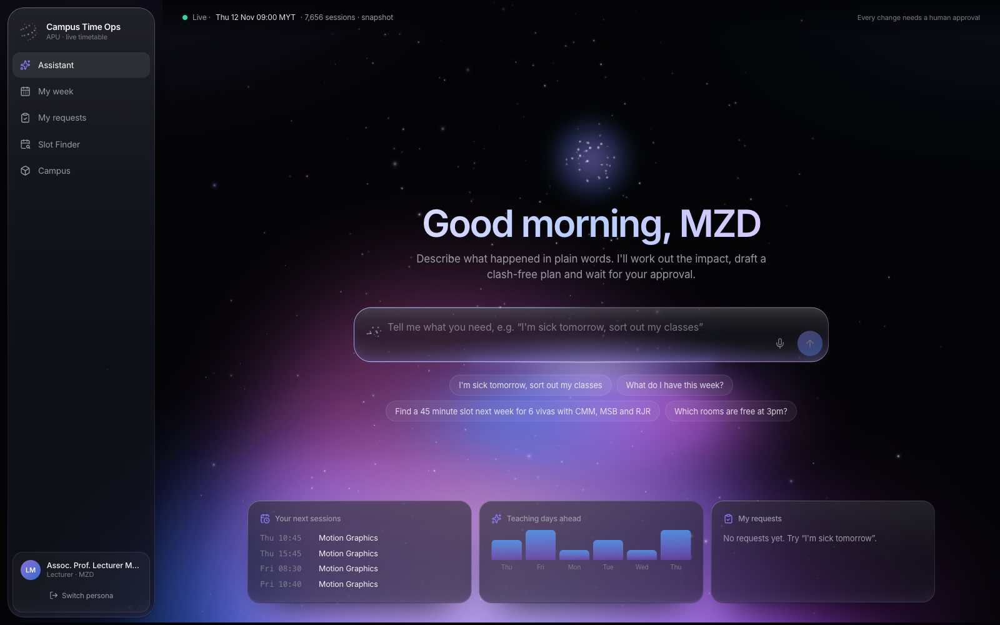

</div>

> *We didn't build a chatbot. We built the layer that lets AI agents actually run university operations, on APU's live timetable, APU's real holidays and APU's own regulations, with a human approving every step.*

APSpace *shows* timetables. Campus Time Ops **re-plans and acts on** them. You say what happened, the agent works out who is affected, drafts a clash-free plan, and waits. Nothing changes until a person clicks **Approve**.

| 🤒 "I'm sick tomorrow" | 🏖️ "Monday is now a public holiday" | 🎓 "How many classes can I miss?" |
|:---:|:---:|:---:|
| 3 classes, ~513 students. 2 covered by a substitute who teaches the same module, 1 moved to a clash-free slot. **0.01 s.** | 598 sessions across the whole campus re-planned by CP-SAT. 94% stay in a room, **zero clashes.** **~2.5 s.** | "You're at 88%. You can miss at most **2 more** classes." Calculated from the real remaining sessions. |

## See it

<table>
<tr>
<td width="50%">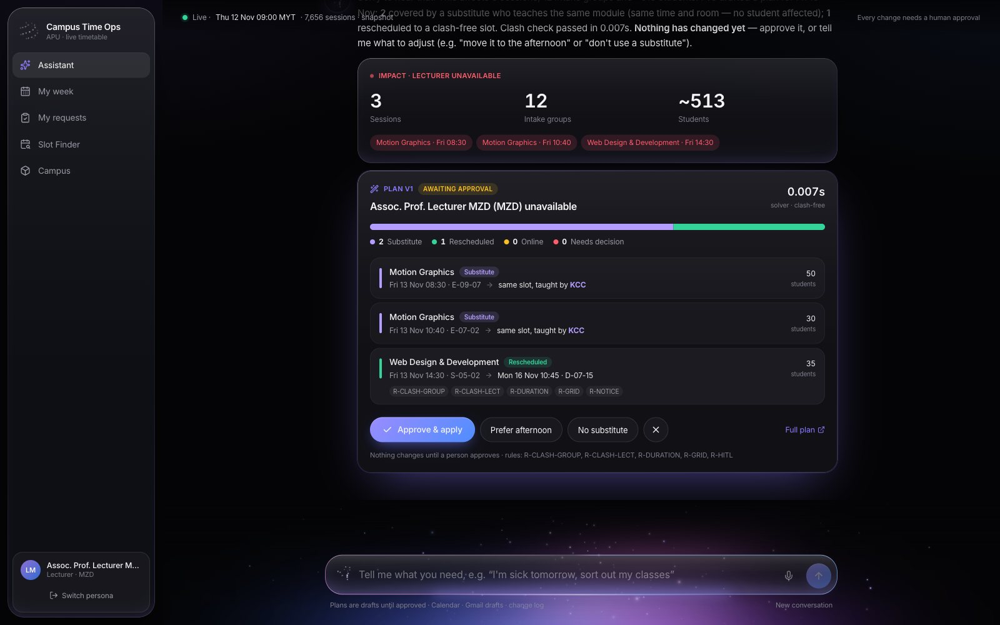<br><b>Sick day → plan → approve.</b> Substitutes first (no student affected), then clash-free reschedules. Every constraint cites an APU rule.</td>
<td width="50%">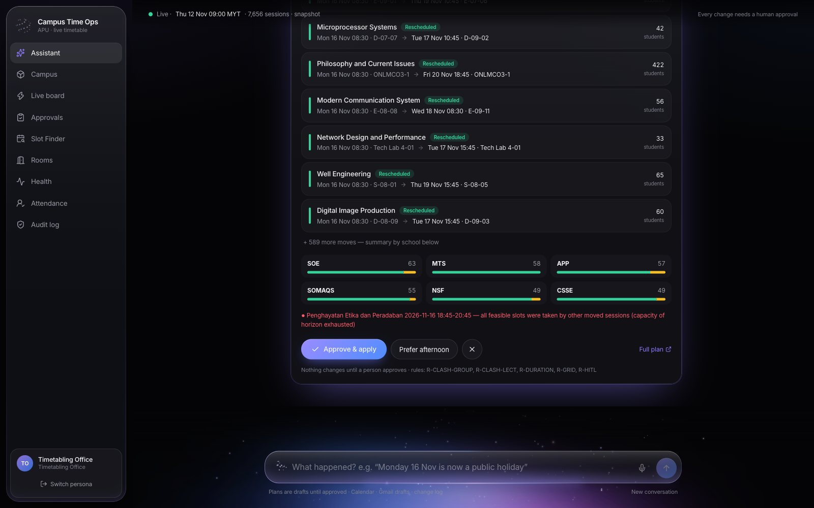<br><b>Whole-campus holiday.</b> 598 sessions re-planned by OR-Tools CP-SAT, broken down by school, with the shuttle and evening rules applied.</td>
</tr>
<tr>
<td>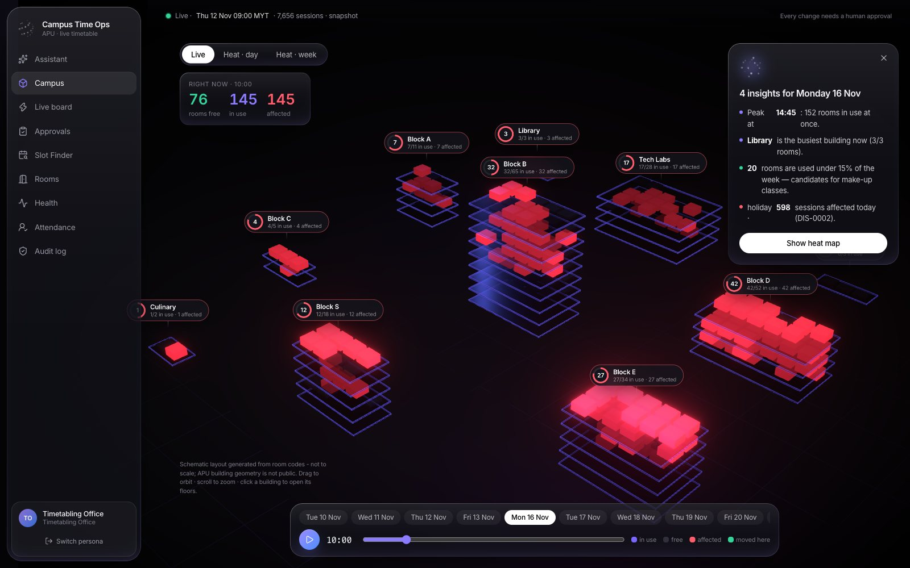<br><b>3D campus.</b> Every room glows by its live state: in use, free, affected or moved here. Time scrubber, day picker and computed insights.</td>
<td>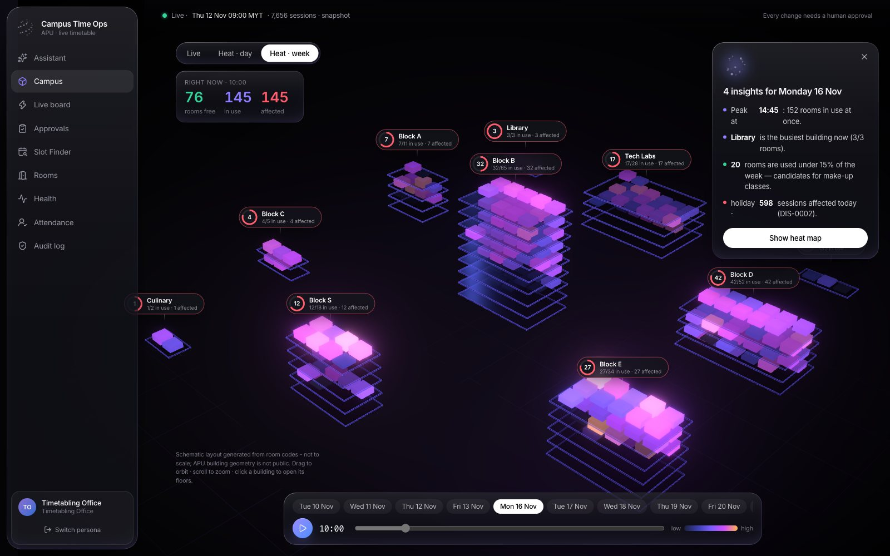<br><b>Week heat map.</b> Which rooms are packed and which sit empty, as candidates for make-up classes.</td>
</tr>
<tr>
<td>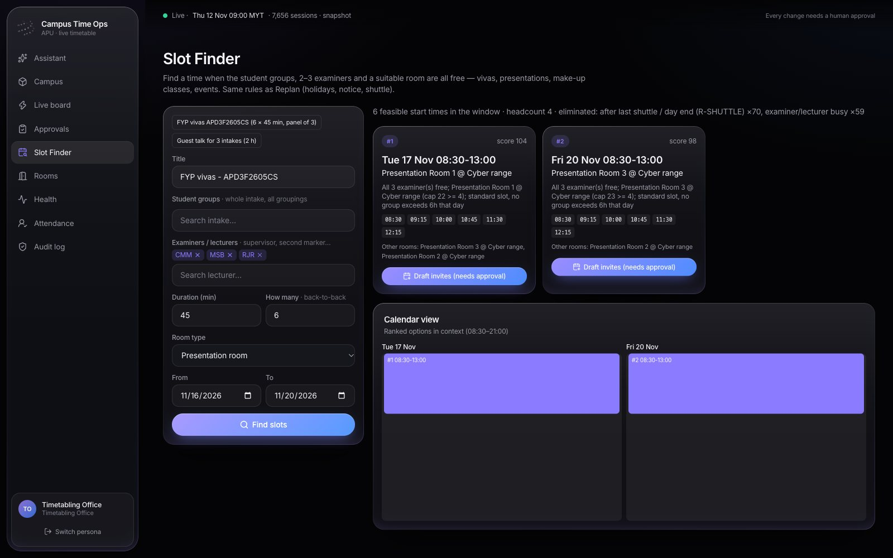<br><b>Slot Finder.</b> Finds times when the student groups, 2–3 examiners and a suitable room are all free (vivas, presentations, make-ups), then drafts the invites.</td>
<td>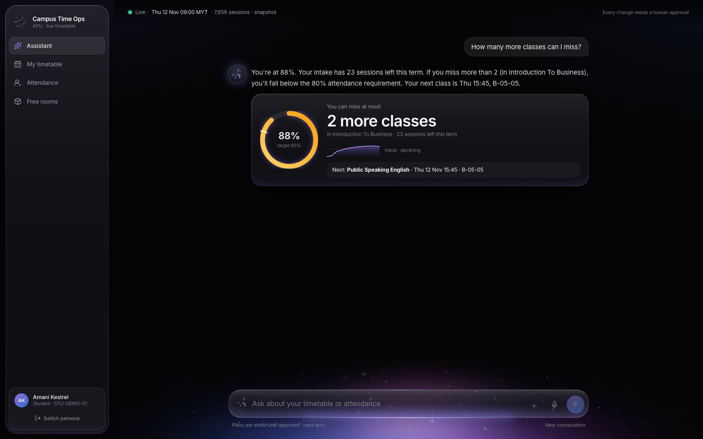<br><b>Student view.</b> Attendance ring and "how many more can I miss", from the real remaining timetable.</td>
</tr>
<tr>
<td>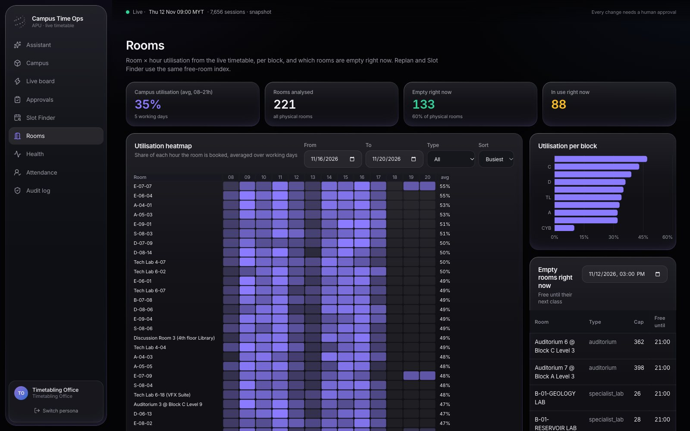<br><b>Rooms.</b> Room × hour utilisation, per-block usage and rooms that are empty right now.</td>
<td>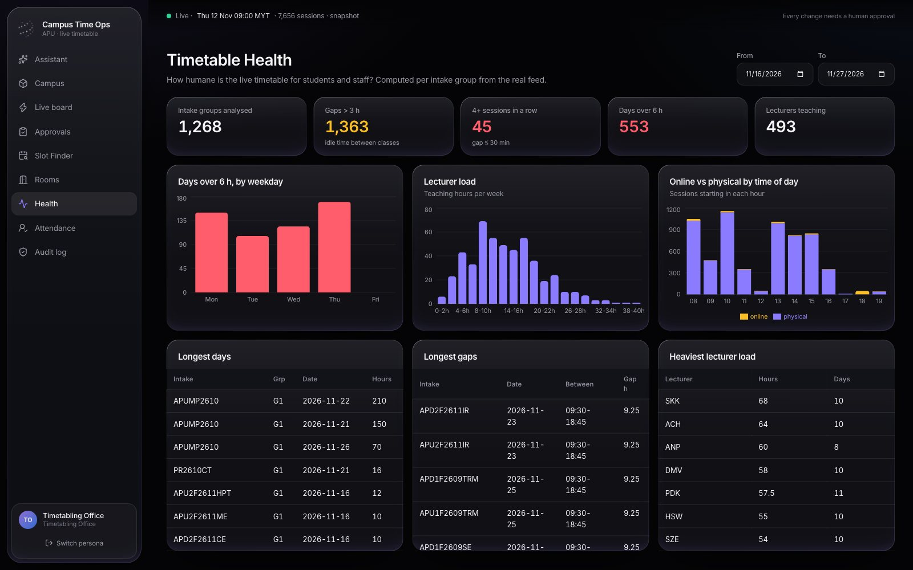<br><b>Timetable Health.</b> Long days, gaps and lecturer load per intake, computed from the live feed.</td>
</tr>
<tr>
<td>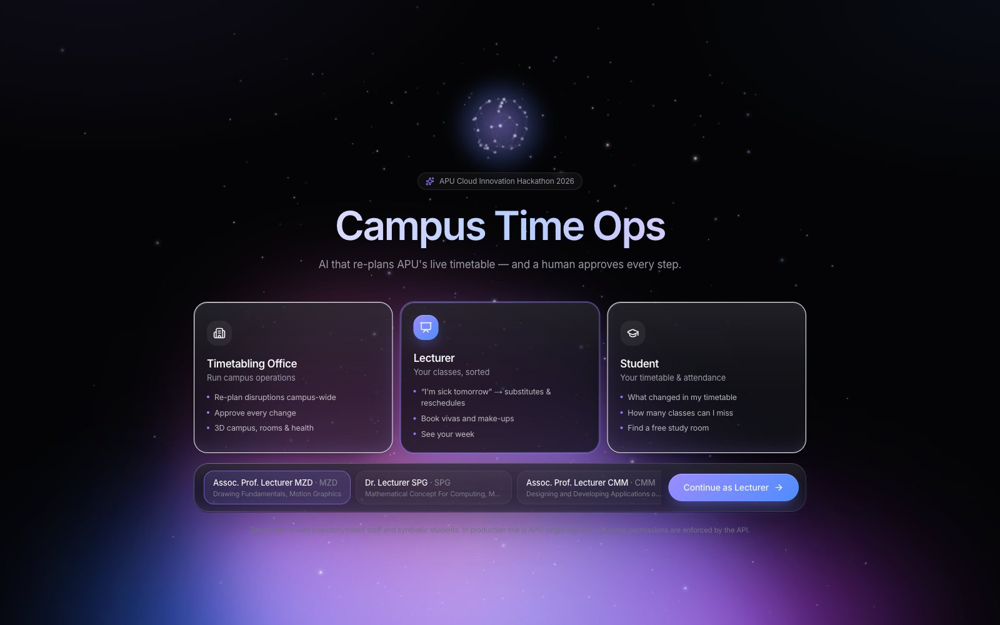<br><b>Three roles.</b> Timetabling Office, Lecturer and Student each get their own home and menu, and the API enforces the permissions.</td>
<td>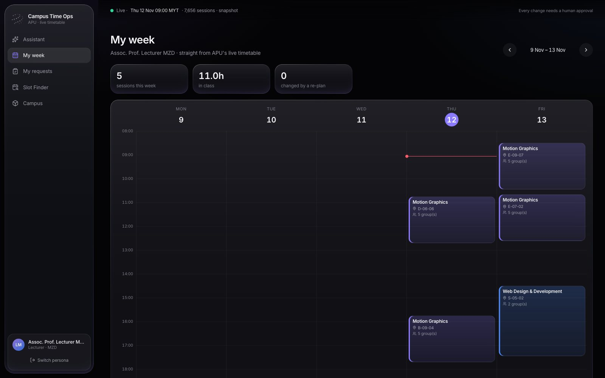<br><b>Lecturer "My week".</b> A visual calendar with every change highlighted.</td>
</tr>
</table>

## How it works

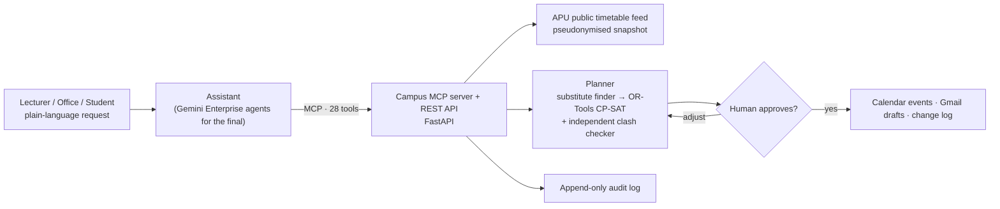

- **Replan.** A lecturer is sick, a room floods, or a holiday is declared. The agent finds every affected class, tries a **substitute lecturer** first (same module, free, within daily load), reschedules the rest with **CP-SAT**, cites the APU rule behind every constraint, and waits for approval. Approval creates **Calendar** events and **Gmail drafts** (never sent automatically) plus a change-log entry.
- **Slot Finder.** Searches the same constraint model for times that work for groups, examiners and rooms.
- **Insights.** 3D campus, rooms heat map, Timetable Health and read-only **Attendance Risk**.

## Quick start (offline, about 2 minutes)
```bash
make setup
```
```bash
make dev
```
The app runs on http://localhost:3000, and the API and MCP server on http://localhost:8000 (`/docs`, `/mcp`). Sign in as **Lecturer MZD** and click **"I'm sick tomorrow, sort out my classes"**, then **Approve & apply**. Then sign in as **Timetabling Office**, say "Monday 16 Nov is now a public holiday", and open **Campus** on Mon 16 Nov.

| Command | What it does |
|---|---|
| `make data` | Fetches the public APU feed, pseudonymises it, writes a dated snapshot, then generates the mocks and the synthetic students |
| `make data-offline` | Regenerates the mocks and synthetic data from the committed snapshot only |
| `make test` | Runs the 65 backend tests, including the solver property tests and the approval-gate tests |
| `make mcp` / `make inspector` | Runs the MCP server alone on :8001/mcp, or opens it in MCP Inspector |
| `make bench` | Re-measures the metrics in `docs/METRICS.md` |
| `make reset-demo` | Restores a clean demo state in under 10 s |
| `make deploy` | Deploys the backend and dashboard to Cloud Run (asia-southeast1). See `docs/SETUP_GOOGLE.md` |

If port 3000 is taken, run `PORT=3100 make frontend`. Configuration lives in `.env` (copy `.env.example`): `DATA_MODE=snapshot|live`, `DEMO_NOW`, `ATTENDANCE_THRESHOLD`, `NOTICE_HOURS`, `WORKSPACE_MODE=local|google`, and `MCP_AUTH_TOKEN`.

## Repository
```
backend/   FastAPI REST + FastMCP server (28 tools), CP-SAT solver, services, tests
frontend/  Next.js app: persona sign-in, assistant home, 3D campus (three.js), role-specific pages
agents/    Gemini Enterprise agent configs + instructions (replan, slot_finder) and ADK fallback (adk_app)
grounding/ APU handbook, holiday schedule, shuttle PDF, campus_ops_policy.md (rules labelled QUOTED / ASSUMPTION / VERIFY)
data/      pseudonymised snapshot, rooms, group sizes, holidays, shuttle, synthetic students
scripts/   fetch, generate, seed Firestore, reset, benchmark, deploy, scope check
docs/      ARCHITECTURE, DECISIONS, DEMO_SCRIPT, REPORT_OUTLINE, METRICS, SETUP_GOOGLE
```

## Measured results (`docs/METRICS.md`)
- **Whole-campus holiday:** 598 sessions solved by CP-SAT to OPTIMAL in about **2.5 s**. 94% stay physical, 5.6% go online and 0.5% are unresolved. **Zero clashes.**
- **Sick lecturer:** across the 10 busiest lecturers on one day, **67%** of sessions were covered by a substitute with no student affected, and the rest were rescheduled.
- **One approval** of a campus holiday produces 597 Calendar events, 378 Gmail drafts and one change-log entry.

## Data & privacy
- **A public feed only.** The timetable comes from APU's *public* feed (`open-ws/weektimetable`). We don't bypass any authenticated APU API. The holidays come from apu.edu.my, the shuttle times from the public PDF, and the rules from the APU Student Handbook.
- **Pseudonymised.** Staff names become deterministic pseudonyms (`Dr. Lecturer MDD`) and usernames are dropped before anything is written to disk. A test checks the committed snapshot.
- **Synthetic students.** All about 3,000 students are generated (`id, name, intake, grouping, attendance_records`), and their attendance is simulated against the real group timetable.
- **A human approves every step.** Action tools refuse any proposal that isn't `APPROVED` (tested). Approvals are recorded in an append-only audit log. The system **only creates Gmail drafts**, and a person sends them. Recipients are limited to the demo Workspace domain.
- **Least privilege.** The MCP endpoint requires a bearer token stored in Secret Manager and is rate-limited. The Cloud Run service account has only the Firestore, Secret accessor and Vertex AI user roles.
- **Running on real APSpace data with APU's permission.** Replace the loader with an authenticated APSpace or timetable API, keep the same service and MCP layer, add SSO (IAP or OAuth) in front of the MCP endpoint and the dashboard, and run a data-protection impact assessment with APU (contact: CTI).

## Status and open items
- **Agent platform:** per the organisers, the 13 Nov prototype does not need Gemini Enterprise. It ships with the in-app assistant plus the MCP server. For the 17 Nov final (Top 5), the Gemini Enterprise agents connect to the same MCP server through Google OAuth. The configs and instructions are ready in `agents/`, and the ADK + Vertex AI fallback also works (D-02).
- **Workspace actions:** the real Google Calendar, Gmail and Docs integration is implemented (`WORKSPACE_MODE=google`). It needs a demo Workspace account (see `docs/SETUP_GOOGLE.md`). Local mode writes real `.ics`, `.eml` and markdown files.
- **Still to do:** interviews (`TBD-interview` in METRICS), verifying the attendance threshold with APU, and the per-stop shuttle times (marked VERIFY).
